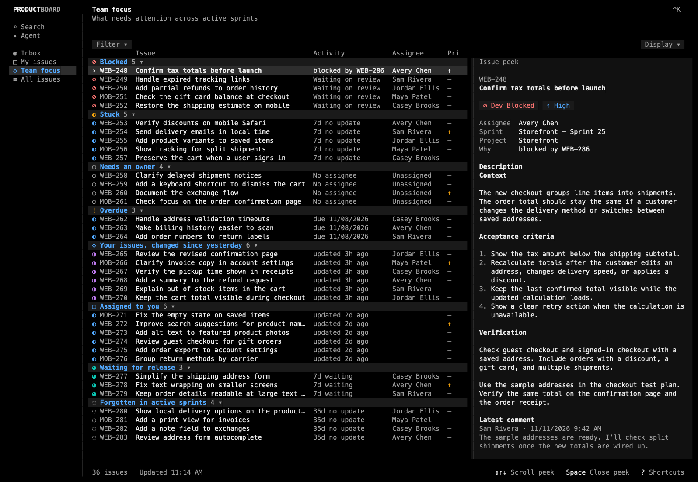

<p align="center">
  
</p>

<p align="center">
  Browse team issues, track your work, and search Jira Cloud from your terminal.
</p>

<p align="center">
  <a href="#installation">Installation</a> |
  <a href="#features">Features</a> |
  <a href="#agent">Agent</a> |
  <a href="#built-with">Built with</a> |
  <a href="#development">Development</a>
</p>

<p align="center">
  
</p>

---

## Installation

```bash
# Homebrew (macOS)
brew install murabcd/tap/productboard
```

The formula includes Bun and installs Node.js for Agent. Update with
`brew upgrade murabcd/tap/productboard`. Run `productboard --version` to see your
installed version, for example `productboard v0.1.3`. See
[GitHub Releases](https://github.com/murabcd/productboard/releases) for version history.

If you previously linked the checkout to `~/.local/bin/productboard`, remove that
symlink so your shell picks up the Homebrew command.

## Getting started

```bash
productboard
```

On first launch, **Connect Jira** asks for your Jira Cloud site, Atlassian
account email, and an [API token without scopes](https://id.atlassian.com/manage-profile/security/api-tokens).
Press `Ctrl+O` on the token prompt to open Atlassian's token page. Productboard
checks your sign-in before saving the token to macOS Keychain.

In **Connect an integration**, choose an OpenAI or Anthropic API key, or choose
**ChatGPT subscription** to use your local Codex sign-in. Select **Skip for now**
to open Inbox with Jira only.

Run `productboard --login` to update your Jira sign-in or
`productboard --check` to verify saved access without opening the dashboard.

Each installation connects directly to the Jira Cloud site and account you supply.
Issue and attachment links open in your default browser. Jira Software boards and
sprints are optional; project filters and issue lists remain usable without them.

## Features

- Use **Team issues → All issues** to browse every issue in the selected scope,
  including completed work. Switch to **Needs attention** for blockers, overdue
  work, and issues that need an owner. Use `←` / `→` or click the tabs to switch;
  project, assignee, sprint, status, and local text filters stay in place.
  Team issues starts with All issues and remembers your last mode across launches.
  Lists load 200 issues at a time; press `n` to load more.
- **Needs attention** checks open work in the selected scope, including work
  outside sprints and Kanban projects. An explicit sprint filter still narrows it.
  If an individual check is unavailable, the footer shows **Partial results**
  and names the missing source. Press `r` to retry.
- Use **Filter → Sprint** to narrow issue lists to one sprint, and **Any sprint**
  to clear the selection. Use **Sprint board** to switch which board supplies the
  sprint choices.
- Find issues assigned to you or created by you. Open **Search**, type words or
  an issue key, then press `Enter` to search across Jira.
- Catch up on mentions in **Inbox**.
- Read comments and preview image attachments in the terminal.
  Open issue peek with `Space` and scroll it with `Shift+↑` or `Shift+↓`.
- [Eve](https://github.com/vercel/eve) powers the **Agent** tab.
  - Search Jira with read-only tools and open issues cited in replies.
  - Attach issues, sprints, and screenshots to give Agent context.
  - Stream replies from OpenAI or Anthropic in the terminal.

The dashboard opens in Inbox. Press `1` for Search, `2` for Agent,
`3` for Inbox, `4` for My issues, and `5` for Team issues.
Use a Nerd Font in your terminal to display the sidebar icons.

To switch themes, press `Ctrl+K`, choose **Change theme**, then select **Vercel
Light**, **Vercel Dark**, or **Default**. The choice is saved for the next
launch. The Vercel themes use the [Geist Terminal palettes](https://vercel.com/geist/terminal).

### Custom workflows

Status grouping uses Jira's To do, In progress, and Done categories. Common English
names add Blocked, In review, Ready for release, and Backlog groups. Jira's Done
category always stays Done. Original status names remain visible on each issue.

For custom or localized names, add an optional `workflow` object to
`~/.config/productboard/config.json`, keeping the existing site and email:

```json
{
  "workflow": {
    "statuses": {
      "На проверке": "In review",
      "Ожидает релиза": "Ready for release",
      "Заблокировано": "Blocked"
    },
    "blockedLinkTypes": ["Blocks", "Блокирует"]
  }
}
```

Status names match exactly, ignoring case and surrounding spaces. Available groups
are `Blocked`, `In progress`, `In review`, `Ready for release`, `Done`, `To do`, and
`Backlog`. `blockedLinkTypes` lists the Jira issue-link type names that mean a
dependency blocks the issue; it defaults to `["Blocks"]`. These mappings apply to
grouping and Needs attention after restarting Productboard. Changing Jira sites
clears the saved board and workflow mappings.

## Agent

Eve runs locally and sends model requests to the provider you connect.

If you skipped Agent during setup, press `Ctrl+K` and choose **Connect Agent**,
or run `productboard --agent-login` to connect or switch providers.
Choose **ChatGPT subscription** to reuse your local Codex CLI login. If needed,
install the Codex CLI and run `codex login` with your ChatGPT account in another
terminal, then press Enter in Productboard. Codex manages your sign-in and plan usage.
For OpenAI or Anthropic API keys, open the key page with `Ctrl+O` and paste the key
into the hidden field. Productboard stores API keys in macOS Keychain.

Open `productboard` and select **Agent** in the sidebar (or press `2`). Ask about any
project, sprint, or issue you can access in Jira. The message box grows as you type.
`Enter` sends and `Shift+Enter` (or `Ctrl+J`) adds a line. While Agent answers,
`Esc` interrupts it. Use `/new` or `Ctrl+N` to start a chat, `Ctrl+↑` / `Ctrl+↓` to
switch between chats, and `Ctrl+O` to open an issue Agent
mentioned. Type `/clear` and press Enter to clear the current chat. This also
stops any reply in that chat.

While a reply is running, `Enter` queues your draft as a follow-up. The queue
appears above the composer with **Edit**, **Cancel**, and **Manage** controls;
`/queue` provides the same actions from the keyboard. Editing keeps a message's
place; `Enter` saves the edit. A stopped or failed reply pauses the queue. Choose
**Resume** to continue. Saved queues reopen paused, including edits in progress.
`Ctrl+Enter` or **Send now** interrupts the current reply and sends your draft
immediately, preserving the partial reply. Other queued messages follow it.

Replies scroll as they stream. Scroll up with the wheel or `PageUp` to keep
your place; scrolling back to the bottom resumes following. Click **Jump to
latest ↓** or press `Ctrl+End` to return immediately. Sending a question also
returns to the latest reply. At the start of the composer, `↑` recalls sent
prompts; at the end, `↓` moves forward and restores your unsent draft.
Use `/copy` to copy the latest answer.
Each reply has **Copy answer** and **Fork chat** actions. `/answers` lets you find
and copy an earlier answer; `/fork` starts a new saved chat through the selected
reply, including its Jira evidence and attachments. The original chat stays intact.

Chats, prompt history, drafts, and attachments survive restarts. Choose **Chats**
or `/chats` to search names, prompts, and answers. `/rename` names the current chat;
`/delete` offers to remove its saved record. Local records are private files under
`~/.local/state/productboard`, separated by Jira account. `/clear` removes the
current record and replaces it with an empty chat.

Use `/compact` between replies to summarize the model's context. The full chat
stays visible and saved. New sessions receive the checkpoint and later turns;
older images stay in the saved chat rather than being sent again. `Esc` cancels
compaction and keeps the previous context.

Jira searches show their JQL, progress, result count, and whether more matches
are available. Click a search row or use `/tools` to inspect its full query,
returned issue summaries, partial-result hint, or failure reason.
Interrupted and failed replies keep their status in the chat.
If a reply fails, its question returns to the empty composer so you can retry.
Transient failures before any answer text receive one automatic retry, with a
visible countdown that `Esc` stops. Partial replies stay intact. Click **Retry**
or use `/retry` to send another attempt; retrying an older reply creates a fork.
Context-limit errors offer **Compact**, and authentication, quota, unavailable
model, rejected-request, and connection failures show their own recovery steps.

Drop an image file into the Agent composer or paste its local path. Images
and long or multiline pastes appear inline as numbered labels. Press
Backspace after a label to remove it. You can attach up to four PNG, JPEG, GIF,
or WebP files, up to 3 MB each and 6 MB total.

Type `@` in the composer to search tasks across Jira and sprints on the current
board. Suggestions appear above the composer as you type. Use `↑` and `↓` to
highlight a result, `Enter` or `Tab` to insert it, or `Esc` to close the list.
Backspace removes an inserted reference. A sprint scopes the next message, and
task references give Agent the issue keys to look up.

Agent sends your prompt and attached images to your provider when you press
Enter. It searches Jira when the question needs issue data. Each search shares
up to 50 matching issue summaries with
current fields such as status, assignee, and priority. Its answers can link back
to Jira issues in the terminal. After reopening a chat, a model or reasoning
change, or a failed or interrupted request,
the next request restores earlier prompts, replies, Jira results, sprint references,
and image attachments to the new Eve session.

### Model providers

OpenAI is the default. Choose a provider during setup or set
`PRODUCTBOARD_AGENT_PROVIDER` to `openai`, `anthropic`, or `chatgpt` in your shell.

- **OpenAI** defaults to GPT-6 Luna (`gpt-6-luna`). Set `OPENAI_API_KEY` to use a key from your shell.
- **Anthropic** defaults to Claude Sonnet 5.5 (`claude-sonnet-5-5`). Set `ANTHROPIC_API_KEY` to use a key from your shell.
- **ChatGPT subscription** starts with the default model from your Codex model list after setup.

Type `/` in an empty Agent composer and choose `/models`, or choose **Select
Agent model** from the `Ctrl+K` menu. The picker opens above
the composer and lists GPT-6 and Claude 5 models for connected API keys and the
models available in your Codex model list. Subscription models appear under
**OpenAI** with a **Subscription** tag. **Recent**
shows your last five distinct model picks, newest first. A dot marks the active
model. Choose a model, then a reasoning level
(None, Low, Medium, High, or Extra high). Use `/effort` to change the current
model's reasoning level directly. The default is Medium. Productboard remembers
both settings and shows them together, for example
"GPT-6 Luna · Medium". Replies show which model answered.

`PRODUCTBOARD_AGENT_MODEL` overrides the model at launch.

## Built with

- [TypeScript](https://www.typescriptlang.org) defines the app's types for issues, sprints, and filters.
- [Bun](https://bun.sh) runs the dashboard and its tests and manages dependencies.
- [OpenTUI](https://github.com/sst/opentui) renders the terminal interface and handles keyboard input.
- [Eve](https://github.com/vercel/eve) runs Agent locally and connects it to your model provider.
- [Jira Cloud REST APIs](https://developer.atlassian.com/cloud/jira/platform/rest/v3/) provide issues and comments. The [Jira Software REST API](https://developer.atlassian.com/cloud/jira/software/rest/) provides boards and sprints.
- [Zod](https://zod.dev) validates Jira responses and local settings before the app uses them.

## Development

Install [Bun](https://bun.sh) on macOS to run from source.
Agent also needs Node.js 24 or newer.

```bash
git clone https://github.com/murabcd/productboard.git
cd productboard
bun install
bun run start
```

Run `bun run check` for Biome lint and formatting checks, TypeScript type
checks, and Bun tests. It also checks repository structure with Konsistent
and validates the [architecture notes](./lat.md/lat.md) with Lat.
