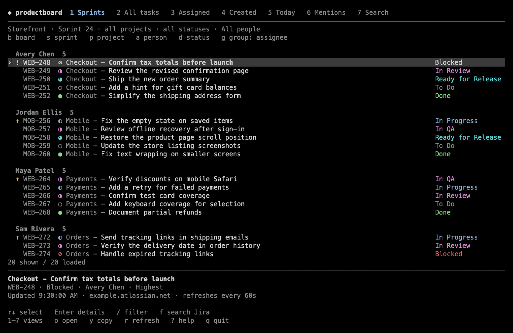

<p align="center">
  
</p>

<h1 align="center">productboard</h1>

<p align="center">
  Browse team sprints, track your issues, and search Jira Cloud from your terminal.
</p>

<p align="center">
  <a href="#installation">Installation</a> |
  <a href="#features">Features</a> |
  <a href="#built-with">Built with</a> |
  <a href="#development">Development</a>
</p>

---

## Installation

Run from the project directory on macOS with [Bun](https://bun.sh) installed.

```bash
bun install
bun run start --login
bun run start
```

Sign in with your Jira Cloud site, Atlassian account email, and an [unscoped API token](https://id.atlassian.com/manage-profile/security/api-tokens).
The dashboard only reads Jira data and stores the token in macOS Keychain.

To run it as `board` from anywhere, link the launcher from the project directory.
Make sure `~/.local/bin` is on your `PATH`.

```bash
mkdir -p ~/.local/bin
ln -s "$PWD/bin/board" ~/.local/bin/board
```

## Features

- Browse team sprints and filter by project, assignee, or status.
- Find issues assigned to you or created by you, and search across Jira.
- See blockers, overdue issues, and mentions in one place.
- Read comments and preview image attachments in the terminal.

## Built with

- [TypeScript](https://www.typescriptlang.org) defines the app's types for issues, sprints, and filters.
- [Bun](https://bun.sh) runs the dashboard and its tests and manages dependencies.
- [OpenTUI](https://github.com/sst/opentui) renders the terminal interface and handles keyboard input.
- [Jira Cloud REST APIs](https://developer.atlassian.com/cloud/jira/platform/rest/v3/) provide issues and comments. The [Jira Software REST API](https://developer.atlassian.com/cloud/jira/software/rest/) provides boards and sprints.
- [Zod](https://zod.dev) validates Jira responses and local settings before the app uses them.

## Development

Run `bun run check` for Biome lint and formatting checks, TypeScript type
checks, and Bun tests. It also checks repository structure with Konsistent
and validates the [architecture notes](./lat.md/lat.md) with Lat.
