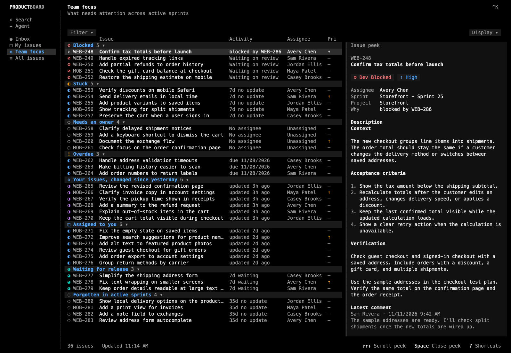

<p align="center">
  
</p>

<p align="center">
  Browse team issues, track your work, and search Jira Cloud from your terminal.
</p>

<p align="center">
  <a href="#installation">Installation</a> |
  <a href="#features">Features</a> |
  <a href="#agent">Agent</a> |
  <a href="#built-with">Built with</a> |
  <a href="#development">Development</a>
</p>

<p align="center">
  
</p>

---

## Installation

```bash
# Homebrew (macOS)
brew install murabcd/tap/productboard
```

The formula includes Bun and installs Node.js for Agent. Update with
`brew upgrade murabcd/tap/productboard`. See [GitHub Releases](https://github.com/murabcd/productboard/releases)
for version history.

If you previously linked the checkout to `~/.local/bin/productboard`, remove that
symlink so your shell picks up the Homebrew command.

## Getting started

```bash
productboard
```

On first launch, **Connect Jira** asks for your Jira Cloud site, Atlassian
account email, and an [API token without scopes](https://id.atlassian.com/manage-profile/security/api-tokens).
Press `Ctrl+O` on the token prompt to open Atlassian's token page. Productboard
checks your sign-in before saving the token to macOS Keychain.

In **Connect an integration**, choose **OpenAI** or **Anthropic** and paste a
provider API key, or select **Skip for now** to open Inbox with Jira only.

Run `productboard --login` to update your Jira sign-in or
`productboard --check` to verify saved access without opening the dashboard.

## Features

- Browse **All issues** and filter by project, assignee, or status.
- Use **Filter → Sprint** to narrow issue lists to one sprint, and **Any sprint**
  to clear the selection. Use **Sprint board** to switch which board supplies the
  sprint choices.
- Find issues assigned to you or created by you, and search across Jira.
- See blockers, overdue issues, and mentions in one place.
- Read comments and preview image attachments in the terminal.
  Open issue peek with `Space` and scroll it with `Shift+↑` or `Shift+↓`.
- [Eve](https://github.com/vercel/eve) powers the **Agent** tab.
  - Search Jira with read-only tools and open issues cited in replies.
  - Attach issues, sprints, and screenshots to give Agent context.
  - Stream replies from OpenAI or Anthropic in the terminal.

The dashboard opens in Inbox. Press `1` for Search, `2` for Agent,
`3` for Inbox, `4` for My issues, `5` for Team focus, or `6` for All issues.

To switch themes, press `Ctrl+K`, choose **Change theme**, then select **Vercel
Light**, **Vercel Dark**, or **Default**. The choice is saved for the next
launch. The Vercel themes use the [Geist Terminal palettes](https://vercel.com/geist/terminal).

## Agent

Eve runs locally and sends model requests to the provider you connect.

If you skipped Agent during setup, press `Ctrl+K` and choose **Connect Agent**,
or run `productboard --agent-login`. Choose a provider, open its key page with
`Ctrl+O`, and paste the key into the hidden field. Productboard stores it in
macOS Keychain.

Open `productboard` and select **Agent** in the sidebar (or press `2`). Ask about any
project, sprint, or issue you can access in Jira. The message box grows as you type.
`Enter` sends and `Shift+Enter` (or `Ctrl+J`) adds a line. While Agent answers,
`Esc` interrupts it. Use `Ctrl+N` to start a chat, `Ctrl+↑` / `Ctrl+↓` to
switch between chats, and `Ctrl+O` to open an issue Agent
mentioned.

Drop an image file into the Agent composer or paste its local path. Images
and long or multiline pastes appear inline as numbered labels. Press
Backspace after a label to remove it. You can attach up to four PNG, JPEG, GIF,
or WebP files, up to 3 MB each and 6 MB total.

Type `@` in the composer to search tasks across Jira and sprints on the current
board. Select a result to insert its reference at the cursor. Backspace removes
the reference. A sprint scopes the next message, and task references give Agent
the issue keys to look up.

Agent sends your prompt and attached images to your provider when you press
Enter. It searches Jira when the question needs issue data. Each search shares
up to 50 matching issue summaries with
current fields such as status, assignee, and priority. Its answers can link back
to Jira issues in the terminal. Productboard keeps chat history for the current
run. Reattach images if you switch models or reasoning levels and want to refer
to them again.

### Model providers

OpenAI is the default. Choose a provider during setup or set
`PRODUCTBOARD_AGENT_PROVIDER` to `openai` or `anthropic` in your shell.

- **OpenAI** defaults to GPT-6 Luna (`gpt-6-luna`). Set `OPENAI_API_KEY` to use a key from your shell.
- **Anthropic** defaults to Claude Sonnet 5.5 (`claude-sonnet-5-5`). Set `ANTHROPIC_API_KEY` to use a key from your shell.

Click the model button on the Agent page or choose **Select Agent model** from
the `Ctrl+K` menu. The picker lists the GPT-6 and Claude 5 models your keys can
use, with the current model first. Choose a model, then a reasoning level
(None, Low, Medium, High, or Extra high). The default is Medium. Productboard
remembers both settings and shows them together, for example
"GPT-6 Luna · Medium". Replies show which model answered.

`PRODUCTBOARD_AGENT_MODEL` overrides the model at launch.

## Built with

- [TypeScript](https://www.typescriptlang.org) defines the app's types for issues, sprints, and filters.
- [Bun](https://bun.sh) runs the dashboard and its tests and manages dependencies.
- [OpenTUI](https://github.com/sst/opentui) renders the terminal interface and handles keyboard input.
- [Eve](https://github.com/vercel/eve) runs Agent locally and connects it to your model provider.
- [Jira Cloud REST APIs](https://developer.atlassian.com/cloud/jira/platform/rest/v3/) provide issues and comments. The [Jira Software REST API](https://developer.atlassian.com/cloud/jira/software/rest/) provides boards and sprints.
- [Zod](https://zod.dev) validates Jira responses and local settings before the app uses them.

## Development

Install [Bun](https://bun.sh) on macOS to run from source.
Agent also needs Node.js 24 or newer for the local [Eve](https://github.com/vercel/eve) runtime.

```bash
git clone https://github.com/murabcd/productboard.git
cd productboard
bun install
bun run start
```

Run `bun run check` for Biome lint and formatting checks, TypeScript type
checks, and Bun tests. It also checks repository structure with Konsistent
and validates the [architecture notes](./lat.md/lat.md) with Lat.
